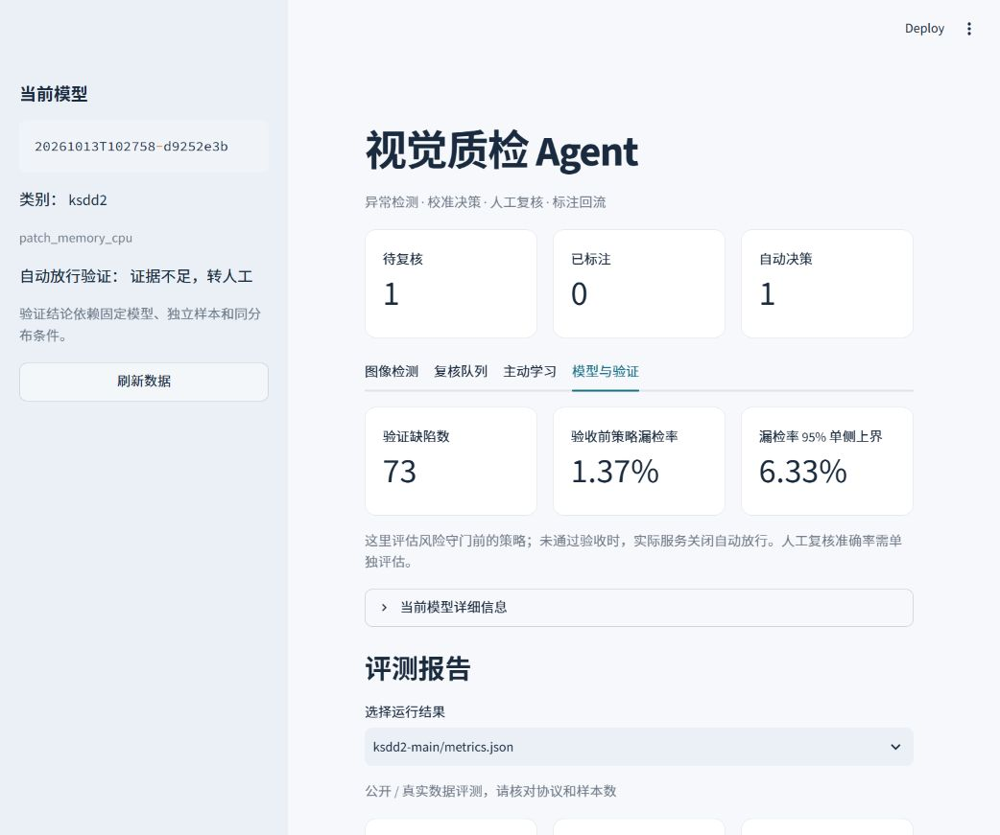

# 视觉质检 Agent


**v2 CPU 研究版已实现。** 正式 Anomalib PatchCore / EfficientAD、原图切片定位、二级 U-Net、真实数据三种子主动学习、模型注册与回滚已接入。自动放行仍关闭；功能完成不等于研究指标或产线风险验收通过。使用方法见 [v2 使用与复现](docs/v2使用与复现.md)，实测见 [v2 验证报告](docs/v2验证报告.md)。下方保留 v1 轻量演示入口，旧版本仍可运行。

**Visual Quality Inspection Agent · CPU anomaly detection, calibrated routing and active learning**

一个可以在 Windows CPU 上运行的异常检测、校准路由、人工复核和主动学习原型。完整研究方案见 [项目计划书](docs/项目计划书.md)。

**主评测使用公开数据集，完整保留官方测试集。合成 demo 仅作工程检查。** 五个数据集的接入命令、协议和数据来源见 [公开数据集评测](docs/公开数据集评测.md)。

**当前默认模型是自研的轻量 patch memory 基线，不是论文版 PatchCore。脚本生成的合成数据和结果只验证流程，不代表工业性能。**

## v1 实测与 v2 方向

| KolektorSDD2 实测项目 | 结果 |
|---|---:|
| 完整官方测试集 | 1,004 张，其中 110 张缺陷 |
| 主检测 Image AUROC | **0.928229** |
| CPU 检测 p50 / p95 | 2.40 / 3.65 ms，不含解码、HTTP、路由 |
| 独立路由风险验收 | 未通过；漏检率 95% 上界 6.33% |
| 当前自动放行 | **关闭**，守门后人工复核率 80.58% |

[v1 发布说明](docs/releases/v1.0.0.md) · [完整实测说明](docs/验证结果.md) · [机器可读结果](results/v1/README.md) · **[v2 加强版规划](docs/v2加强版规划.md)**

v2 优先接入真实 PatchCore / EfficientAD、原分辨率定位和独立风险验收，然后验证二级分割与真实主动学习收益。v2 中的目标尚未实现。



## 已实现

- 正常图像训练、异常分数、热力图与候选框。
- 独立分数概率拟合、按标签分组的 conformal 预测集合、漏检率精确单侧置信上界。
- 放行 / 报警 / 人工复核；未知类别、图像统计漂移、验收证据不足进入复核。
- FastAPI、中文 Streamlit、SQLite 反馈历史、冲突检测、重复上传幂等及约 5% 抽检。
- random / uncertainty / coreset 选样；人工标注生成候选模型；新独立数据重新校准。
- 路由对照、鲁棒性、主动学习曲线；CPU 延迟基准；等价 PyTorch / ONNX Runtime 导出与对比。
- MVTec AD / VisA / BTAD / KolektorSDD2 / MVTec LOCO 本地数据导入；真实 PatchCore / EfficientAD 可选训练脚本。

可选深度模型尚未在本机训练，也尚未接入默认推理服务。U-Net/YOLO、VLM、GPU 性能及产线验证留待真实数据阶段，见计划书的实施边界。

## 快速开始

需要 Python 3.11+。CPU 版已在 Windows / Python 3.14 本地验证。新电脑先克隆并生成演示模型：

```powershell
git clone https://github.com/richhhh350/vision-qc-agent.git
cd vision-qc-agent
powershell -ExecutionPolicy Bypass -File scripts/setup.ps1
powershell -ExecutionPolicy Bypass -File scripts/start.ps1
```

已运行过 setup 的电脑只需执行 start。数据集、虚拟环境和训练模型不随 Git 仓库分发；真实数据版本请先完成 [下载与训练](docs/公开数据集评测.md)，再用 `scripts/start.ps1 -Run runs/ksdd2-routing -State runs/state-ksdd2` 启动。当前实测模型未通过 1% 漏检风险验收，保留报警与人工复核，自动放行关闭；结果快照见 `results/v1/`。

看板：<http://127.0.0.1:8501>；API 文档：<http://127.0.0.1:8000/docs>。默认仅监听本机。日志与进程信息保存在 `runs/`。

停止本项目启动的服务：`powershell -ExecutionPolicy Bypass -File scripts/stop.ps1`。

体验流程：上传 `data/demo/test/test-0000.png` 查看正常样本；上传 `test-0080.png` 查看缺陷；输入不同产品类别观察强制复核；在复核队列保存标签。在正式回流演示中，请使用 `data/demo/pool/` 或新图像，测试集图片不能进入训练。

或手动安装（核心服务只需 `.[dev]`；ONNX 和绘图需要对应 extras）：

```powershell
python -m venv .venv
.\.venv\Scripts\python.exe -m pip install -e ".[dev,onnx,plots]"
.\.venv\Scripts\python.exe -m vision_qc.cli demo
.\.venv\Scripts\python.exe -m uvicorn vision_qc.api:create_app --factory --host 127.0.0.1 --port 8000
# 另一个终端
.\.venv\Scripts\python.exe -m streamlit run dashboard.py --server.address 127.0.0.1
```

项目不自动读取 `.env`，本地请用 PowerShell 环境变量设置；Compose 会读取 `.env`。`.env.example` 列出了可用变量。

## 训练与实验

```powershell
.\.venv\Scripts\python.exe -m vision_qc.cli train --manifest data/your_manifest.csv --output runs/product-a
.\.venv\Scripts\python.exe -m vision_qc.cli evaluate --run runs/product-a --manifest data/your_manifest.csv
.\.venv\Scripts\python.exe -m vision_qc.cli experiments --run runs/demo --manifest data/demo/manifest.csv --seed 42
.\.venv\Scripts\python.exe scripts/plot_experiments.py --directory runs/demo/experiments/seed-42
.\.venv\Scripts\python.exe -m vision_qc.cli benchmark --run runs/demo --image data/demo/test/test-0080.png
.\.venv\Scripts\python.exe -m vision_qc.cli export-onnx --run runs/demo --image data/demo/test/test-0080.png
.\.venv\Scripts\python.exe -m pytest -q
```

新类别小样本适应：`python scripts/adapt_category.py --reference-run runs/demo --manifest data/new-category-routing.csv --output runs/adaptation`。它只用验证集选择样本预算，合格后只评一次测试；多预算候选均关闭放行，上线前需要新验收集。

每个训练命令创建新目录，拒绝覆盖。报告保存为 `metrics-test.json`、`predictions-test.json`、`benchmark.json` 和 `experiments/seed-*/` 下的 CSV。报告里的延迟不包含 HTTP、图像解码与磁盘写入，详细边界随结果保存。

`experiments` 的主动学习曲线是固定 pool 上的离线 oracle 仿真；缺陷标签不会进入正常记忆库。由于选样使用原校准数据，这些自适应曲线没有复用校准的覆盖保证。比较多个种子时分别指定 `--seed`。

## 人工反馈闭环

```powershell
.\.venv\Scripts\python.exe -m vision_qc.cli retrain --run runs/demo --state runs/state --output runs/candidate-01
# 准备全新、独立的 calibration 和 validation 图片，使用相同类别的 manifest
.\.venv\Scripts\python.exe -m vision_qc.cli recalibrate --run runs/candidate-01 --manifest data/fresh_manifest.csv --output runs/calibrated-01
```

候选版本关闭自动放行；旧模型与旧标签历史保留。`recalibrate` 固定候选权重，拒绝与历史实验或反馈图像重叠的校准/验收样本。只有新的风险上界通过，才可能重新开启放行。

切换版本：停止现有服务后，执行 `scripts/start.ps1 -Run runs/calibrated-01`；回滚时换回 `runs/demo` 或旧生产目录。当前是显式重启切换，不做热更新。

## 数据清单

```csv
id,path,category,split,label,group,mask
a001,images/good.png,pcb,train,0,batch01-part01,
a002,images/scratch.png,pcb,calibration,1,batch02-part03,masks/scratch.png
```

路径相对 manifest，也可以是绝对路径。split 支持 `train/dev/prob_fit/calibration/acceptance/test/pool`，兼容 v1 的 `validation`；label 为 0=正常、1=缺陷，只有 pool 可为空；mask 非零像素表示缺陷。

每个模型仅一个产品类别，train 只允许正常。重复图像不能跨集合；同一工件及其增强图像填同一 group。只含正常校准集时无法证明缺陷漏检率，系统不会自动放行。默认风险阈值 1%，小校准集会导致高复核率。

```powershell
.\.venv\Scripts\python.exe scripts/import_dataset.py --kind mvtec --root D:/datasets/mvtec --category bottle --output data/bottle.csv
.\.venv\Scripts\python.exe scripts/import_dataset.py --kind visa --root D:/datasets/VisA --category pcb1 --output data/pcb1.csv
.\.venv\Scripts\python.exe scripts/benchmark_public.py --manifest data/bottle.csv --output runs/bottle-main
```

默认 `--protocol official`：所有官方训练正常图进入 train，官方训练缺陷（若有）放入 pool，完整官方测试集保留为 test。主评测用 `benchmark_public.py`，只报告检测与定位，不生成风险证书。路由实验改用 `--protocol routing`，仅在官方训练部分继续划分。MVTec 等没有训练缺陷时，自动放行将保持关闭。真实数据需自行补充工件/批次 group；不同许可见计划书。

## v2 正式深度模型

本机已验证 Python 3.14、Anomalib 2.2.0、PyTorch 2.12.1。Windows 安装版本记录在 `requirements-v2-tested.txt`。v2 模型目录可直接用于同一 FastAPI / Streamlit 服务：

```powershell
powershell -ExecutionPolicy Bypass -File scripts/setup-v2.ps1
.\.venv-v2\Scripts\python.exe scripts/v2.py train --manifest data/ksdd2-v2.csv --output runs/my-v2 --config configs/v2/patchcore-letterbox256.json
powershell -ExecutionPolicy Bypass -File scripts/start.ps1 -V2 -Run runs/my-v2 -State runs/state-v2
```

训练需要真实数据与预训练权重。完整准备、EfficientAD 对照、二级反馈、独立重校准、ONNX 和回滚命令见 [v2 使用与复现](docs/v2使用与复现.md)。`scripts/train_anomalib.py` 保留为旧的独立框架实验入口。

## Docker

先在本机生成 `runs/demo` 后，执行 `docker compose up --build`。容器默认仅通过本机映射端口访问。Windows 上生成的绝对数据路径不适合直接在容器中重训练；容器训练请在容器内生成 manifest / 运行目录。Docker 文件已提供，本机未安装 Docker，未声称完成容器构建验证。

## 目录

```
src/vision_qc/      检测、校准、路由、队列、实验、服务和 CLI
dashboard.py       中文操作界面
scripts/           安装、启动、数据导入、绘图和可选深度训练
tests/             统计边界、数据隔离、API 与反馈集成测试
docs/              完善后的计划书与实际验证结果
results/v1/        不含原图和个人路径的汇总评测快照
results/v2/        深度模型、逐图预测、三种子学习与几何对照证据
data/              本地数据，不纳入 Git
runs/              模型、报告、SQLite、上传图像，不纳入 Git
```

## 许可与数据来源

源码尚未指定开源许可证。公开数据、权重和依赖分别遵循原发布者条款，详见 [第三方说明](docs/第三方说明.md)。本仓库不上传原始数据集、人工复核图片、凭据或数据库。
