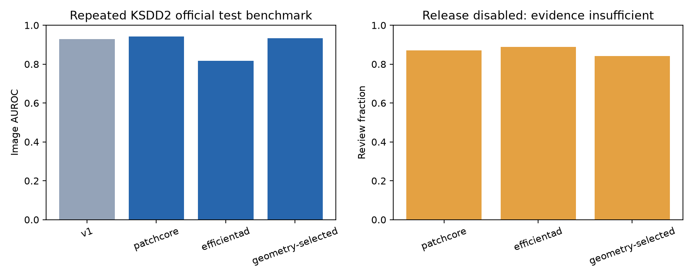
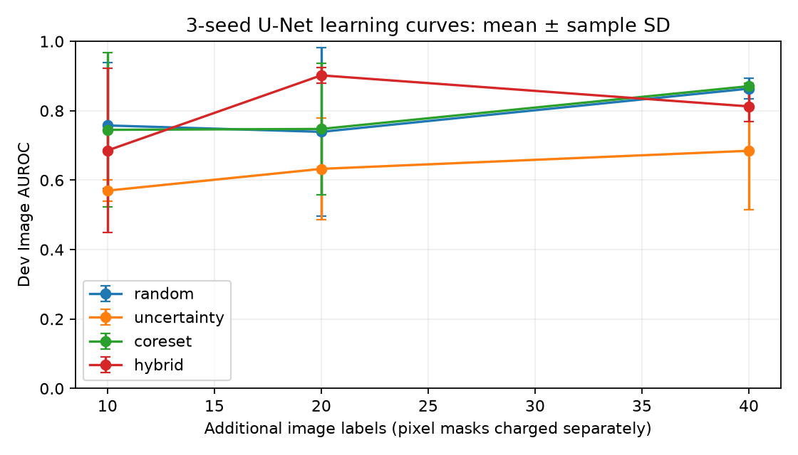

# v2 验证报告

验证日期：2026-10-14。交付为 CPU 研究版；所有结果来自本机执行。功能完成情况和科学/业务目标分开记录。

## 完成范围

统一深度检测器、等比例/切片原图坐标定位、完整策略证书校验、新证据重校准、U-Net 像素反馈、后台候选任务、三种子主动学习、ONNX 候选核验、模型注册提升与回滚均已实现。FastAPI 和中文看板能运行 v1/v2；旧模型不被新训练覆盖。

## 检测与定位

KSDD2 官方 test 共 1,004 张（894 正常、110 缺陷）。v1 使用了 2,085 张正常训练图；v2 路由协议给一级训练 1,042 张正常图，其他训练图用于独立开发/校准/研究验收。因此这是不同完整配置的持续基准比较，不是控制所有因素的模型消融，更不是全新的最终盲测。

| 配置 | Image AUROC | 原图 Pixel AUROC（分箱） | 原图 AUPRO@0.3（近似） | 实际复核率 |
|---|---:|---:|---:|---:|
| PatchCore / 256 切片 | 0.9418 | 0.9565 | 0.9376 | 87.05% |
| PatchCore / 256 等比例（开发集选中） | 0.9343 | 0.9899 | 0.9387 | 84.16% |
| EfficientAD / CPU 预算 | 0.8167 | 0.8349 | 0.6989 | 88.94% |

v1 Image AUROC 为 **0.9282**。v2 三个配置均未达到 ≥0.96 的研究目标；EfficientAD 预算消融结果较差，不能据此推断完整论文训练配方的能力。

开发集：256 切片 AUROC 0.9007，256 等比例 0.9575，384 等比例 0.9534。服务采用开发集选中的 256 等比例配置；没有因为切片方案测试分数较高再改选。384 方案未再读取官方测试结果。

像素指标使用恢复到原图尺寸的热力图和原始掩膜，8,192 个 atan 分箱，4 连通区域。分箱 AUROC 的误差上界、缺失掩膜数、面积区间区域命中率保存在 JSON。v1 的 96×96 像素指标与 v2 原图指标评估口径不同，不作直接提升百分比。

## 路由风险与人工成本

| 配置 | 验收缺陷 | 未加证书限制的策略漏检 | 单侧 95% 漏检上界 | 放行状态 |
|---|---:|---:|---:|---|
| PatchCore / 256 切片 | 50 | 1 | 9.14% | 关闭 |
| PatchCore / 256 等比例（开发集选中） | 50 | 2 | 12.06% | 关闭 |
| EfficientAD / CPU 预算 | 50 | 0 | 5.82% | 关闭 |

50 个缺陷即使零漏检，上界也约 5.82%，远高于 1%。这批数据也没有独立产线采样证明。关闭自动放行后的实际零放行漏检不能被宣传为通过风险目标。完整证书绑定权重、预处理、阈值、二级配置、类别、证据指纹与有效期；改变后重新验收。

相同工件不能通过重复增强/切片增加独立样本数。重新校准拒绝历史图像/组重叠，并在评分前登记单次使用；证书字段缺失、NaN、过期、权重损坏、策略变化均失效。正式激活还约束正常自动误报率 ≤10%。

本次没有证明相对 v1 复核率降低 ≥25%。按 0.1%、1%、5% 缺陷基率重加权的复核率在各 metrics-test.json 中；重加权依赖类条件分布稳定，不能当作产线收益。

## 二级分割与主动学习

真实原训练池有 268 张（211 正常、57 缺陷）。4 策略 × 3 种子（17/42/2026）× 3 累计预算（10/20/40），每轮重新训练相同结构的小 U-Net；主检测器冻结。dev 上重复评估，仅用于研究曲线，不生成风险证书。

初始 60 步、均匀图块训练出现全背景退化，负结果保留于 learning-uniform60。根据训练日志和开发结果修正为已标注缺陷/正常图块均衡采样、200 步，并重新比较全部策略。改动发生在开发阶段，应视为探索性实验；没有声称最初预注册或使用了新的盲测。每次训练保存实际看到的缺陷图块数量。

| 策略 | 10 标签 AUROC 均值±SD | 20 标签 | 40 标签 |
|---|---:|---:|---:|
| random | 0.7576 ± 0.1811 | 0.7393 ± 0.2426 | 0.8637 ± 0.0292 |
| uncertainty | 0.5699 ± 0.0308 | 0.6326 ± 0.1469 | 0.6847 ± 0.1704 |
| coreset | 0.7451 ± 0.2216 | 0.7476 ± 0.1895 | 0.8708 ± 0.0086 |
| hybrid | 0.6856 ± 0.2366 | 0.9020 ± 0.0233 | 0.8126 ± 0.0446 |

达到预设开发集 AUROC 0.96 的策略/种子组合：**0/12**。未达到的明确记为 `not_reached`。仅凭这些结果不能证明节省 ≥20% 标注成本，也不能把 3 个种子视为 3 份独立产线证据。

选样先写选择记录再揭示 oracle 标签；策略函数拒绝 label/mask 输入。每轮包含模型版本、选中分数、嵌入、条件抽样概率、揭示标签、掩膜成本与训练耗时。图像成本含既有一级训练/概率拟合/校准/研究验收标签，开发评估标签单列；像素掩膜单独计数，没有测得的人工标注秒数记为 null。

二级只在实际 review 路由调用，输出不参与放行。因而“一级+二级建议”的自动路由/漏检/复核率与一级一致；单独 U-Net 的 AUROC 和复核子集的二级 AUROC 分别报告，不把两个不同分数直接混排来夸大级联精度。正常反馈更新一级正常训练集，缺陷反馈须有当前像素掩膜才能训练二级。

## ONNX、性能与工程检查

- v2-patchcore：32 张开发样本，数值核验通过，原始路由翻转 0；分数/热力图/嵌入容差 atol=0.001、rtol=0.001。
- v2-geometry-selected：32 张开发样本，数值核验通过，原始路由翻转 0；分数/热力图/嵌入容差 atol=0.001、rtol=0.001。
- v2-efficientad：32 张开发样本，数值核验通过，原始路由翻转 0；分数/热力图/嵌入容差 atol=0.001、rtol=0.001。
- 完整演示策略（一级 + 条件二级 + 路由 + 存储），单并发 batch=1，预热 10 次后测 200 次 HTTP：p50 **159.8 ms**，p95 **227.3 ms**，吞吐 **5.99 张/秒**。250 ms 预算达到。
- 硬件 13th Gen Intel(R) Core(TM) i7-1360P，推理 4 线程；按 manifest 的 dev 顺序取样，计时样本为 198 张正常、2 张缺陷，二级调用比例 92.5%。图像尺寸及逐阶段 p95 见压测 JSON；该数字不外推到其他样本比例、硬件或并发量。
- 服务及子进程采样峰值 RSS **712.0 MiB**；模型权重 **11.5 MiB**。RSS 为逐请求采样峰值，不能当成 OS 精确峰值。
- 本机最终 39 项测试全部通过；pip check 通过；2.0.0 wheel 构建通过。正式深度契约测试使用随机初始化做离线接口检查，真实准确率只引用上面的 KSDD2 实验。
- 实际执行了注册→提升→回滚→再次提升。服务看板已用真实图验证上传、报警、人工复核、原图叠图与二级参考输出。
- 新增 GitHub Actions 深度契约配置尚未推送/运行；Docker 未安装，容器构建尚未验证。Torch/JIT 在 Python 3.14 的弃用提示来自上游，记录在测试日志，不影响本次通过结果。

## 后续范围

真实产线新验收数据、MVTec/VisA 全类别矩阵、完整 EfficientAD 论文训练、特征空间漂移监测、VLM 文本说明、热更新和分布式任务队列未完成，仍为后续扩展。本次不宣称产线可直接上线。

## 证据文件

- [汇总与源码指纹](../results/v2/summary.json)、[环境](../results/v2/environment.json)、[数据协议](../results/v2/data-protocol.json)。
- 每个模型子目录包含逐图预测、校准/验收统计、权重哈希收据及 ONNX 检查；完整权重和原图留在本地 runs/data。
- [学习实验](../results/v2/learning/learning.json)、[原始负结果](../results/v2/learning-uniform60/learning.json)、[HTTP 压测](../results/v2/http-benchmark.json)。
- 含工业原图的困难样例拼图仅保存于本地 `runs/v2-report-artifacts/hard-cases.png`，不纳入仓库。

方法参考：[Anomalib PatchCore](https://anomalib.readthedocs.io/en/v2.2.0/markdown/guides/reference/models/image/patchcore.html)、[EfficientAD 原论文](https://arxiv.org/abs/2303.14535)。上述数值是本项目实测，不是论文指标。
